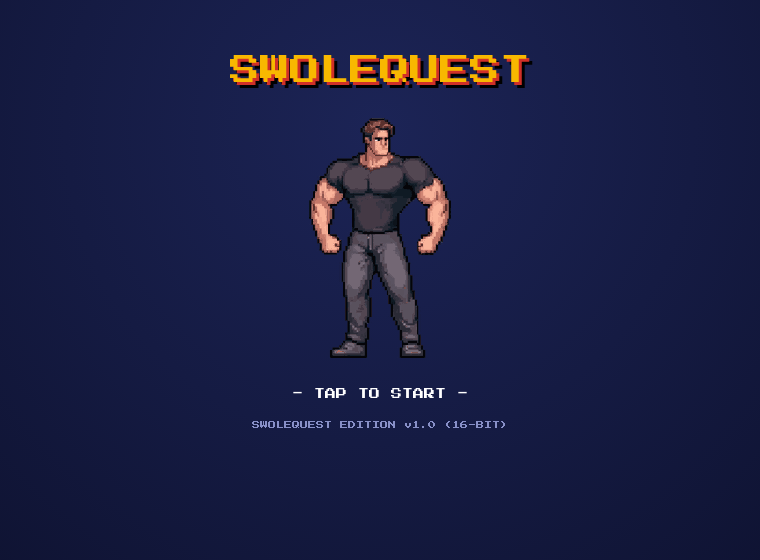
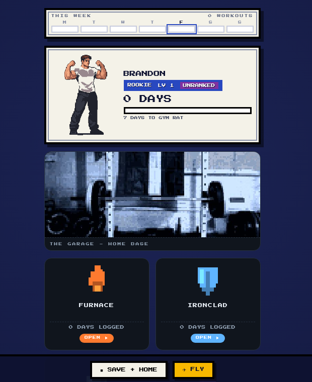
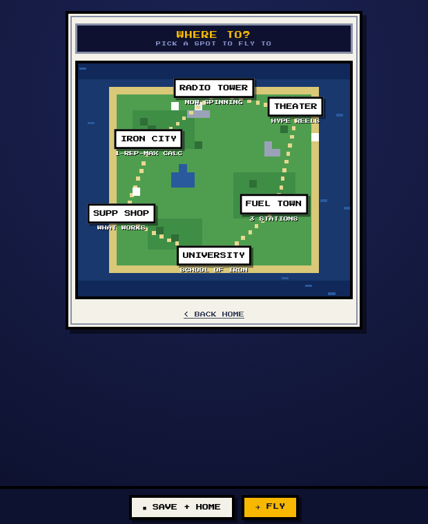

<div align="center">



# SWOLEQUEST

**A workout tracker disguised as a 16-bit lifting RPG.**

Build a trainer. Run an actual program. Log the work. Watch the little dude get unreasonably large.

[](https://bjepp77.github.io/swolequest/)
[](https://bjepp77.github.io/swolequest/)
[](manifest.webmanifest)
[](#how-it-works)

[Try it](https://bjepp77.github.io/swolequest/) · [See the system](#how-it-works) · [Run it locally](#run-it-locally)

</div>

---

## Why this exists

Most workout trackers feel like tax software with dumbbells.

SwoleQuest takes the useful parts - prescribed workouts, progression, lift history, nutrition tools, and evidence you can inspect - then wraps them in the feedback loops of a handheld RPG. The product bet is simple: adherence gets easier when progress feels visible.

It is a product and interaction-design experiment first. No account maze. No subscription funnel. No dashboard that needs its own onboarding dashboard.

## The loop

1. **Build your trainer.** Pick a 16-bit or Game Boy Color look, then set the starting build that feels honest.
2. **Choose a program.** Four original programs sit in the main hub: FURNACE, IRONCLAD, FOUNDATIONS, and SWOLE.
3. **Log the work.** Workout history stays on the device. Strength history feeds suggested weights across the program ecosystem.
4. **Get the payoff.** Logged days level the trainer, advance evolution stages, unlock loot, and reveal trophies.
5. **Learn the why.** The University's Research Desk links the training claims behind the original programs to 27 peer-reviewed papers.

<div align="center">
  
</div>

## More than a logbook

| System | What it does |
|---|---|
| **Trainer creator** | Two pixel-art styles, multiple poses, appearance settings, rank, and logged-day evolutions |
| **Program hub** | Routes into four original training programs while preserving separate tracker state |
| **Progression** | Weekly workout strip, levels, evolution milestones, loot drops, gym bag, and trophy case |
| **Skill Check** | Estimates the big-four 1RMs and assigns a strength tier relative to bodyweight |
| **Gains Ledger** | Charts weight over time by exercise |
| **Iron City** | 1RM estimator and plate calculator |
| **Fuel Town** | Mifflin-St Jeor calorie targets, daily macro logging, and macro-counted recipes |
| **Supp Shop** | Supplements grouped by evidence grade, with the marketing fog removed |
| **University** | Training lessons plus a Research Desk with links to the cited literature |
| **Theater + Radio Tower** | Lifting videos and a deliberately small music shelf, because fake abundance is still fake |
| **Install flow** | PWA manifest and personalized home-screen icon support |

<div align="center">
  
</div>

## Product decisions hiding under the pixels

### Local-first on purpose

Core workout and trainer data lives in browser `localStorage`. There is no user account or workout database. That keeps the product cheap to run, fast to open, and private by default. It also creates a real constraint: data does not sync across devices. The trackers' Settings screens use export/import as the bridge.

### One hub, separate programs

SwoleQuest is a small ecosystem rather than one swollen codebase. The hub owns identity, navigation, shared progress, and cross-program strength history. Each program remains a self-contained tracker at a stable URL, with its own release path and local data store.

### Gamification follows the behavior

The RPG layer rewards completed training days. It does not invent a second economy the user has to babysit. Levels, evolutions, loot, and trophies make the real behavior visible instead of asking the lifter to do chores for imaginary coins.

### Evidence stays inspectable

The original programs were checked against 27 peer-reviewed papers. The app exposes those sources in the Research Desk rather than laundering them through a confident paragraph. A claim can be fun. The receipt still needs to exist.

## How it works

```text
GitHub Pages
└── swolequest/                  # hub, trainer, progression, tools, research
    ├── index.html               # self-contained HTML, CSS, JavaScript, and pixel art
    ├── manifest.webmanifest     # install metadata
    ├── icon-180.png
    ├── icon-192.png
    ├── icon-512.png
    └── the-garage.jpg           # owner-supplied photography

Program routes
├── /furnace/                    # cut-focused program
├── /ironclad/                   # 8-week powerbuilding program
├── /bedrock/                    # FOUNDATIONS, 3-day minimalist program
└── /swole-tracker/              # 10-week hypertrophy program

On-device state
├── trainer + evolution progress
├── weekly completion state
├── per-program workout logs
├── shared strength history
├── macro targets + daily food log
└── trophies + inventory

Small sanctioned service
└── swolequest-icons.vercel.app  # renders personalized install icons/manifests
```

The hub ships as plain HTML, CSS, and JavaScript. No framework. No build step. The giant `index.html` is deliberate: copy it, serve it, and the product runs.

## Run it locally

```bash
git clone https://github.com/Bjepp77/swolequest.git
cd swolequest
python3 -m http.server 8080
```

Open [http://localhost:8080](http://localhost:8080).

A local server is better than opening `index.html` directly because the app loads its manifest and version file over HTTP.

## Current edges

This README is not going to put a fake mustache on the tradeoffs.

- **No device sync.** Workout state is local to one browser unless the user exports and imports it.
- **No automated test suite yet.** The current product is manually verified in the browser.
- **The hub is intentionally monolithic.** That makes deployment boring, but the file will need clearer module boundaries as the product grows.
- **Radio Tower is infrastructure with an intentionally small crate.** It only gets tracks the creators actually choose.
- **The marketplace cards are gated previews, not a live commerce system.**

## What I was testing

SwoleQuest started as a question: can a utility product borrow the emotional clarity of a game without becoming a game-shaped distraction?

The useful lessons so far:

- Progress should be visible before the user goes hunting for it.
- Defaults should remove thinking without removing control.
- A playful interface still needs honest data rules.
- Product constraints can be features if they are stated plainly.
- A working artifact beats a 40-slide thought experiment. Every time.

## Project map

| Surface | Repository | Live route |
|---|---|---|
| Hub | [`Bjepp77/swolequest`](https://github.com/Bjepp77/swolequest) | [SwoleQuest](https://bjepp77.github.io/swolequest/) |
| FURNACE | [`Bjepp77/furnace`](https://github.com/Bjepp77/furnace) | [Open](https://bjepp77.github.io/furnace/) |
| IRONCLAD | [`Bjepp77/ironclad`](https://github.com/Bjepp77/ironclad) | [Open](https://bjepp77.github.io/ironclad/) |
| FOUNDATIONS | [`Bjepp77/bedrock`](https://github.com/Bjepp77/bedrock) | [Open](https://bjepp77.github.io/bedrock/) |
| SWOLE | [`Bjepp77/swole-tracker`](https://github.com/Bjepp77/swole-tracker) | [Open](https://bjepp77.github.io/swole-tracker/) |

## Rights and reuse

Photography in this repository comes from Brandon Jeppson's personal collection and is not licensed for reuse outside this project. See [`LICENSES.md`](LICENSES.md).

No general software license is included in the repository right now, so the code should not be treated as open source until one is added.

---

<div align="center">

**Built by [Brandon Jeppson](https://github.com/Bjepp77) as a product experiment with an alarming amount of protein powder in its vocabulary.**

[ENTER SWOLEQUEST →](https://bjepp77.github.io/swolequest/)

</div>
